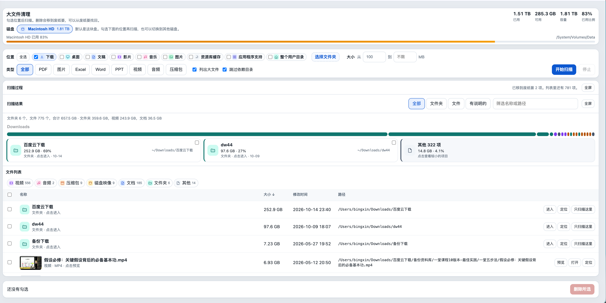
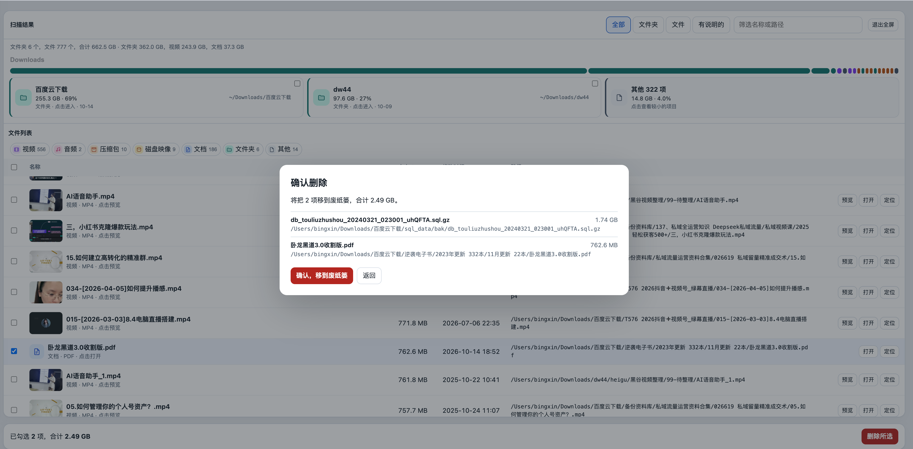

# 大文件清理

在 macOS 上扫描本机大文件，勾选后确认，再移到废纸篓。页面只监听 `127.0.0.1`。

一个 Python 文件，只用标准库。浏览器里操作。

## 截图

扫描结果：文件夹占比、类型筛选和文件列表。



删除前会列出每一项的名称、大小和完整路径。确认后移到废纸篓。



截图来自一次真实扫描，里面能看到本机用户目录和文件名。

## 运行

需要 macOS，以及 Python 3.9 或更高版本。

```bash
python3 disk_cleanup.py
```

浏览器会打开 [http://127.0.0.1:8765/](http://127.0.0.1:8765/)。

```bash
python3 disk_cleanup.py --no-open
python3 disk_cleanup.py --port 8765
```

关掉运行这个脚本的终端，服务就停了。重启后，内存里的扫描结果会清空，需要再扫一次。

图片和常见视频可以在页面里预览，用的是系统自带的 `qlmanage`。跨卷移动到废纸篓时，会用 Xcode 命令行工具里的 `swiftc` 编译一个很小的辅助程序，放在 `~/.cache/disk-cleanup/`。

## 用法

1. 默认扫启动磁盘上的用户目录。可以改选磁盘，或点「选择文件夹」。
2. 在用户磁盘上，位置包括下载、桌面、文稿、影片、音乐、图片、资源库缓存、应用程序支持，以及整个用户目录。外接磁盘按整个挂载点扫描。
3. 大小用 MB 填写。默认从 100 MB 起，上限留空表示不限。两端都是 0 到 10240 的整数。
4. 类型可以多选：PDF、图片、Excel、Word、PPT、视频、音频、压缩包。选了具体类型时，只找这些扩展名，不统计文件夹。
5. 「跳过依赖目录」会跳过 `node_modules`、`.git`、`DerivedData`、`.next`、`Pods`、`__pycache__`、`target`、`vendor`。
6. 扫完后，上面是占比条和文件夹卡片，下面是文件列表。点文件夹进入下一层，点文件用系统默认程序打开。
7. 勾选后点「删除所选」。确认框列出名称、大小和完整路径。确认后移到废纸篓，并在脚本旁边追加一行 `delete-log.txt`。这个日志只留在本机，不进入版本库。

列表最多保留最大的 2000 项。

## 删除边界

删除是移到废纸篓，可以在废纸篓里找回。

这些位置不能删：

- 用户主目录本身，以及桌面、文稿、下载、资源库、影片、音乐、图片、公共、应用程序这些顶层文件夹
- `/Applications`
- 应用程序包、照片图库、音乐库内部的文件
- `PROTECTED_PREFIXES` 里的路径。默认是空的，在 `disk_cleanup.py` 顶部按绝对路径填写，例如：

```python
PROTECTED_PREFIXES = ("/opt/important", "/data/keep")
```

扫描根目录只接受 `/Users`、`/Volumes`、`/Applications`、`/opt`、`/usr/local`、`/tmp` 下面的真实目录。

服务没有登录。同一台电脑上能访问 `127.0.0.1` 的程序，都能打开这个页面。不要把端口暴露到局域网。

## 许可

[MIT](LICENSE)
